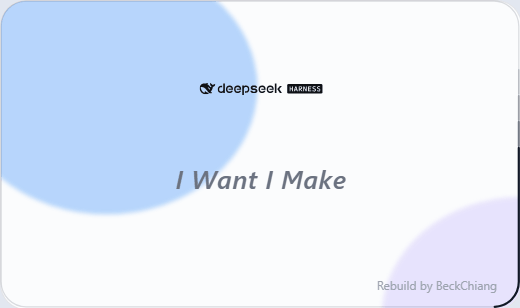
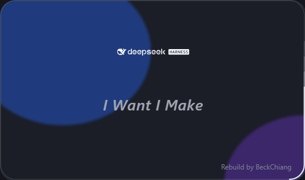

# Real Startup Animation (RSA)

A DeepSeek Harness plugin that shows a fully configurable splash screen **before** the main window appears — a real startup animation rendered by the Electron main process, not a wrapper launcher.

## Preview

| Light | Dark |
| --- | --- |
|  |  |

> 28-frame loop rendered from the actual splash page; the credit line sits bottom-right.

- 设置页：**设置 → RSA 启动画面**
- 中英双语、浅色/深色跟随 DSH 主题
- 实时预览（改参数即时看到效果）
- 深度部署：把渲染结果写进 DSH 的 `app.asar`，下次启动生效
- 一键恢复默认（当前方案即默认）

## 安装

```powershell
# 在 DSH 会话里安装本地插件
plugin_manager install_bundle <本仓库路径>
```

安装后在 DSH 设置里打开 **RSA 启动画面**。

## 部署机制

1. 点「深度部署」→ 插件读取当前配置 → 生成 `lib/splash.cjs` → 重打包出 `resources/app.asar.rsa-new`。
2. **重启 DSH 一次**：进程退出后，插件在下次启动 2.5 秒时把 pending 复制成 `app.asar`（`applyPending()`），并删除 pending。
3. **再启动一次**：这次启动才加载新 asar，显示新画面。

之所以要两次：Windows 下 `app.asar` 被运行中的 Electron 占用（文件锁），无法热替换。

首次部署时会创建 `resources/app.asar.rsa-backup` 作为回滚点（只建一次）。

回滚：退出 DSH，把 `app.asar.rsa-backup` 复制回 `app.asar`。

> DSH 升级会覆盖 `app.asar`，届时需要重新部署一次。

## 配置项

| 分组 | 可调 |
| --- | --- |
| 窗口 | 宽、高、圆角半径 |
| 主题 | 跟随系统 / 强制浅色 / 强制深色，浅色与深色卡片不透明度 |
| Logo | 倍率（0.1×–5×，1× = 320 px 基准宽，等比且不超过窗口宽）、距顶距离、自定义浅色/深色图 |
| 中心文字 | 内容、字号、字体、字重、斜体、距顶、动效（rise/fade/none）、周期、逐字延迟、字距 |
| 署名 | 内容、字号、是否显示、四角位置、偏移 |
| 背景光球 | 开关、动效（float/drift/pulse）、速度、两个光球透明度 |
| 进度光环 | 开关、样式（band/dots/breathe）、光带长度、周期、拖尾、线宽 |

## 开发结构

```
plugins/rsa/
├─ index.js            # host：/rsa 路由（state / preview / config / reset / deploy）
├─ client.js           # client：settings.section 设置页
├─ cordis.patch.yml    # 插件挂载声明
├─ package.json
├─ locale/             # en / zh-CN 元数据
├─ lib/
│  ├─ defaults.mjs     # 默认配置 + normalizeConfig 校验
│  ├─ render.mjs       # 参数化 splash HTML + CJS 生成
│  ├─ asar.mjs         # asar 读写/重打包（original-fs）
│  ├─ deploy.mjs       # 部署、pending 应用、备份
│  ├─ store.mjs        # 配置与状态持久化（data/）
│  └─ brand-*.svg      # 官方矢量 logo（浅色/深色）
└─ data/               # 运行时配置与状态（不入库）
```

## 已知限制

- `setShape` 圆角裁剪依赖 Electron 版本；DSH 桌面端（Electron 44）可用。
- 启动画面窗口是 `transparent + frame:false + setShape`；非 DSH 桌面端不适用。
- 插件只改 `app.asar`，不碰官方 exe，不会触发 SmartScreen。
- 设置页的实时预览通过 `POST /rsa/preview` 生成，iframe 以 `srcdoc` 渲染。

## 许可

MIT
